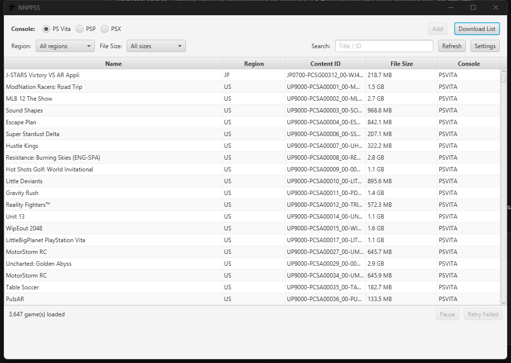
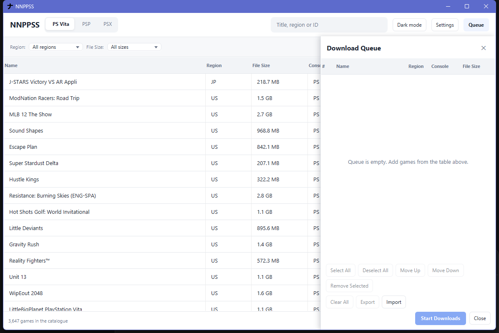
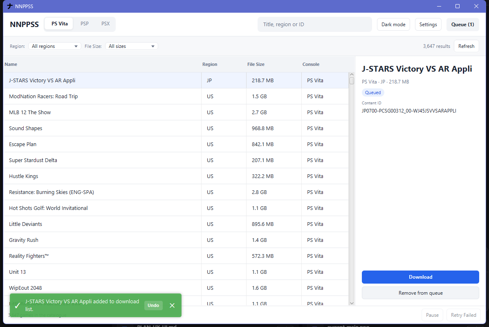

# Plan de mejora UI/UX — NNPPSS

| Campo | Valor |
|---|---|
| Fecha | 2026-11-20 |
| Versión de partida | 1.0.0 (JavaFX) |
| Objetivo | Flujo moderno, limpio y comprensible para descargar un juego |
| Documento | Plan de diseño y hoja de ruta; no cambia la lógica de descargas |
| Referencia visual | `docs/ux/current-main.png` |

---

## 0. Resumen ejecutivo

La app **funciona**, pero hoy se siente como una herramienta interna: la barra superior acumula 14 controles, la acción principal no existe como tal, y descargar un juego obliga a pasar por una confirmación y un diálogo modal de cola. El usuario tiene que descubrir el flujo en lugar de seguirlo.

La propuesta es una **ventana única con tres zonas**: catálogo, detalle del juego y una cola lateral; una barra inferior de descargas que aparece solo cuando hay actividad. El flujo principal queda en **tres acciones**: seleccionar un juego → pulsar “Descargar” → ver el progreso. La cola deja de ser un diálogo y pasa a ser un panel con contador, y “Añadir a la cola” queda como acción secundaria con opción de deshacer.

**Esfuerzo estimado:** 19–24 días hábiles (≈4 semanas), en siete fases agrupadas en cuatro entregas incrementales. No requiere reescribir la lógica de descargas, la persistencia ni el empaquetado.

---

## 1. Objetivo y principios

### Objetivo de experiencia

Que una persona que abre NNPPSS por primera vez pueda **encontrar un juego y ponerlo a descargar sin instrucciones**, y que quien gestiona varias descargas entienda en todo momento **qué está pasando, qué puede hacer y qué pasará después**.

### Principios de diseño

1. **Una acción principal por pantalla.** “Descargar ahora” en el catálogo, “Iniciar descargas” en la cola, “Guardar” en ajustes.
2. **El flujo se ve, no se adivina.** La acción principal siempre está visible; los botones deshabilitados explican por qué.
3. **Una sola ventana.** La cola y los ajustes se abren como paneles laterales, no como ventanas modales que bloquean el catálogo.
4. **Menos pasos, menos confirmaciones.** Solo se confirma lo destructivo (cancelar, borrar, limpiar). Añadir a la cola se puede deshacer.
5. **Estado siempre visible.** Cola, descargas activas, espacio libre y resultado de la última acción tienen un lugar fijo.
6. **Consistencia visual.** Un sistema de tokens (espaciado, tipografía, color, radios) sustituye estilos sueltos.
7. **Accesible por teclado.** Todo el flujo se puede completar sin ratón, con foco visible y atajos documentados.
8. **Sin sorpresas.** Nada de diálogos que aparecen encima de otro diálogo; los errores se muestran junto al campo o en la zona afectada.

### Métricas de éxito

| Métrica | Objetivo |
|---|---|
| Acciones para la primera descarga | ≤ 3 (seleccionar, Descargar, confirmar si hiciera falta) |
| Tiempo hasta iniciar la primera descarga | < 60 s con la app ya configurada |
| Éxito en tarea (5 usuarios) | ≥ 90 % |
| Clics para pausar una descarga | 1 (control inline en la tarjeta) |
| SUS (System Usability Scale) | ≥ 75 |
| Recuperación de error | Toda alerta tiene una acción de reintento o de configuración |
| Regresiones funcionales | 0 en los 36 tests actuales + nuevos flujos TestFX |

---

## 2. Diagnóstico de la interfaz actual



La captura corresponde a 1040×739 px: la app no aprovecha el espacio, la tipografía base es de 12 px y la tabla tiene filas de ~24 px. Los problemas detectados:

| # | Severidad | Fricción | Evidencia |
|---|---|---|---|
| 1 | Alta | **Barra superior saturada**: consola, “Add”, “Download List”, región, tamaño, búsqueda, refrescar y ajustes compiten en una sola fila. | 14 controles sin agrupación ni jerarquía. |
| 2 | Alta | **No hay acción principal**: “Add” está deshabilitado hasta seleccionar una fila y “Download List” parece la acción importante. | El usuario no sabe cuál es el siguiente paso. |
| 3 | Alta | **Flujo de 7 pasos y dos contextos**: seleccionar → confirmar → abrir cola modal → seleccionar → iniciar → cerrar → gestionar. | Diálogo modal de cola sobre el catálogo. |
| 4 | Alta | **Tabla densa y truncada**: “Content ID” se corta y no hay detalle; las filas no muestran estado de historial. | Captura: IDs con “…” y filas de 24 px. |
| 5 | Media | **Estado técnico, no humano**: “3,647 game(s) loaded” no dice qué consola ni qué puede hacer el usuario. | Barra inferior. |
| 6 | Media | **Cola modal redundante**: título “Download Queue” duplicado, mensaje de vacío repetido, sin contador ni reordenación por arrastre. | `DownloadListView.fxml` y captura del diálogo. |
| 7 | Media | **Ajustes como formulario crudo**: URLs sin probar, sin secciones, sin validación inline, guardado con alerta. | `ConfigView.fxml`. |
| 8 | Media | **Primera ejecución abrupta**: se abre un formulario modal antes de explicar qué es la app o qué necesita (pkg2zip, URLs). | `MainApp` + `ConfigView`. |
| 9 | Media | **Estados pobres**: carga con una etiqueta, vacío con un texto, error en notificación transitoria; no hay acción de recuperación. | `MainController` / `NotificationPane`. |
| 10 | Media | **Notificaciones flotantes** arriba a la derecha, sin historial ni acción (deshacer/reintentar). | `NotificationPane`. |
| 11 | Baja | **Sin identidad visual**: todo es Modena por defecto; no hay iconos, marca ni jerarquía tipográfica. | Captura. |
| 12 | Baja | **Accesibilidad limitada**: controles pequeños, sin mnemónicos, estados solo por color, atajos ocultos. | Radios de 12 px, filas coloreadas. |
| 13 | Baja | **Tamaño mínimo 900×600**: el panel de detalle y la cola necesitan más ancho; a 125–150 % de escala se pierde contenido. | `MainApp`. |
| 14 | Baja | **Textos concatenados** (“N game(s)”) en vez de pluralización real. | `status.loaded`, `queue.stats`. |

### Flujo actual (7 pasos)

1. Abrir la app; si no hay URLs, aparece el formulario de configuración.
2. Elegir consola y buscar/filtrar.
3. Seleccionar una fila y pulsar “Add” (o doble clic).
4. Confirmar en un diálogo “Do you want to add…?”.
5. Abrir “Download List” en otra ventana modal.
6. Seleccionar el juego y pulsar “Start Downloads”; el diálogo se cierra.
7. Gestionar la descarga en las barras inferiores, con “Pause”/“Retry Failed” al otro lado de la ventana.

**Problema:** el paso 4 y el 5 no aportan información nueva; el usuario cambia de contexto dos veces y pierde el hilo.

---

## 3. Flujo objetivo

### Camino principal

1. **Abrir** la app (configurada) → catálogo con la consola recordada.
2. **Buscar/seleccionar** un juego → panel de detalle con “Descargar ahora” y “Añadir a la cola”.
3. **Descargar** → se crea la descarga, se abre la barra inferior y se muestra el progreso.
4. **Gestionar** desde la barra inferior: pausar, reanudar, cancelar, ver cola.
5. **Cola** disponible en todo momento con contador; se abre como panel lateral y no bloquea el catálogo.

### Flujo por lotes (secundario)

1. Seleccionar varios juegos con Ctrl/Shift.
2. Pulsar “Añadir seleccionados” en la barra contextual de la tabla.
3. Abrir la cola, revisar el total y el espacio libre, “Iniciar descargas”.

### Primera ejecución

1. Bienvenida breve: qué hace la app y qué necesita (pkg2zip).
2. Configurar al menos una URL de biblioteca con botón “Probar”.
3. Elegir idioma y tema; “Empezar”.
4. Si se omite, la pantalla principal muestra un estado vacío con “Configurar bibliotecas”.

### Reglas de interacción

- **Un clic** selecciona el juego y actualiza el detalle.
- **Doble clic** o **Enter** ejecuta “Descargar ahora”.
- **Añadir a la cola** no pide confirmación; muestra un snackbar con “Deshacer”.
- Si el juego ya se descargó, se muestra un badge “Ya descargado” en el detalle, con la opción de volver a descargar; no se bloquea el flujo.
- Si el enlace es `MISSING`, `CART ONLY` o `NOT REQUIRED`, el botón “Descargar” se deshabilita y el detalle explica el motivo.
- **Cancelar** y **borrar archivos** sí piden confirmación, con el nombre del juego y el número de elementos.
- **Esc** cierra el panel de cola, el de ajustes o un diálogo. **Ctrl+F** enfoca la búsqueda. **Espacio** pausa/reanuda la descarga seleccionada. **Supr** cancela la seleccionada.

---

## 4. Arquitectura de pantalla

### Ventana principal

```
┌──────────────────────────────────────────────────────────────────────────────┐
│ ◆ NNPPSS      [ PS Vita ] [ PSP ] [ PSX ]        🔍 Buscar…      ☾   ⚙   Cola 3 │
├──────────────────────────────────────────────────────────────────────────────┤
│  Región ▾     Tamaño ▾     [ Solo pendientes ]                  3.647 resultados │
├───────────────────────────────────────────────────────┬──────────────────────┤
│  Título                                    Región  Tamaño │  Detalle            │
│  ─────────────────────────────────────────────────────  │  Título del juego    │
│  J-STARS Victory VS AR Appli                 JP    218 MB │  PS Vita · JP        │
│  ModNation Racers: Road Trip                 US    1.5 GB │  218.7 MB            │
│  …                                                       │  [ Descargar ahora ] │
│                                                          │  [ Añadir a la cola ]│
├───────────────────────────────────────────────────────┴──────────────────────┤
│  Descargas (2)   [████████░░] 64 %   32.4 MB/s   ETA 02:10   [Pausar] [Cola]  │
└──────────────────────────────────────────────────────────────────────────────┘
```

- **App bar** (56 px): marca, consola como control segmentado, búsqueda global, tema, ajustes, cola con badge.
- **Barra de filtros** (44 px): región, tamaño, “solo pendientes”, contador de resultados y enlace “Limpiar”.
- **Contenido**: tabla virtualizada (flex) + panel de detalle (320 px, ocultable).
- **Barra de descargas** (48–120 px, colapsable): resumen global y controles; solo visible cuando hay actividad o al abrir la cola.
- **Barra de estado** (28 px): consola/base de datos, espacio libre y último mensaje.
- Ancho mínimo recomendado: **1100×720**; a menos de 1100 el detalle se oculta y la cola se superpone.

### Panel de cola (drawer derecho)

```
┌ Cola de descargas (3) ───────────────────────── ✕ ┐
│ ⠿  Juego A              PS Vita    1.2 GB      ✕ │
│ ⠿  Juego B              PSP       800 MB       ✕ │
│ ⠿  Juego C              PSX       320 MB       ✕ │
│                                                   │
│  Total 2.3 GB · Espacio libre 120 GB              │
│  [ Iniciar descargas ]                            │
└───────────────────────────────────────────────────┘
```

- Ancho 380 px, no modal; se cierra con `Esc` o clic fuera.
- Reordenar con arrastre o botones ↑/↓ (accesible).
- Contador en el botón de la app bar (`Cola 3`).
- Estado vacío: icono + “Tu cola está vacía” + “Explorar juegos”.

### Ajustes (panel lateral o diálogo ancho)

Secciones con encabezados y ayuda contextual:

- **Bibliotecas**: URL de PS Vita, PSP, PSX; botón “Probar” por URL con estado (éxito/error); validación inline.
- **Descargas**: descargas simultáneas (1–4), límite de velocidad, auto-eliminar `.pkg`.
- **Apariencia**: tema claro/oscuro, idioma (con aviso de reinicio).
- **Acerca de**: versión, ruta de datos, enlace a logs.

Pie fijo: “Cancelar” y “Guardar”. Guardar no abre una alerta; cierra el panel y muestra un snackbar.

### Primera ejecución

```
┌ Bienvenido a NNPPSS ─────────────────────────────┐
│ Descarga y organiza tus juegos de PS Vita, PSP   │
│ y PSX.                                            │
│                                                   │
│ [1  Bibliotecas]  [2  Preferencias]               │
│                                                   │
│ URL PS Vita  [________________________] [Probar]  │
│ URL PSP      [________________________] [Probar]  │
│ URL PSX      [________________________] [Probar]  │
│                                                   │
│ ☐ Modo oscuro        Idioma [Español ▾]           │
│                                                   │
│ [ Configurar después ]              [ Empezar ]   │
└───────────────────────────────────────────────────┘
```

---

## 5. Sistema visual

### Tipografía

- Base: **13 px**, línea 18; tabla 13; títulos 20/16/14; metadatos 11–12.
- Pesos: 400 normal, 600 semibold para títulos y acciones, 700 solo para la marca.
- Familia del sistema (`Segoe UI Variable` en Windows, `SF Pro` en macOS, `Inter`/`Noto Sans` en Linux); no depender de una fuente instalada para que el layout no cambie.

### Espaciado y formas

- Escala: 4, 8, 12, 16, 24, 32 px.
- Altura de controles: 36 px; filas de tabla: 40 px (cómoda) o 32 px (compacta).
- Radios: 6 px controles, 8 px tarjetas/paneles.
- Bordes: 1 px `#E4E7EC`; foco: 2 px azul; sombra suave solo en paneles flotantes.

### Color (tokens semánticos)

| Token | Claro | Oscuro |
|---|---|---|
| `bg` | `#F7F8FA` | `#111318` |
| `surface` | `#FFFFFF` | `#1A1D24` |
| `surface-alt` | `#F2F4F7` | `#22262F` |
| `border` | `#E4E7EC` | `#2A2F3A` |
| `text` | `#1D2433` | `#E6E8EE` |
| `text-muted` | `#667085` | `#98A2B3` |
| `primary` | `#2563EB` | `#60A5FA` |
| `success` | `#16A34A` | `#4ADE80` |
| `warning` | `#D97706` | `#FBBF24` |
| `danger` | `#DC2626` | `#F87171` |

Los tokens se declaran como colores con nombre en `.root` y se sobrescriben en `.root.dark`; las vistas usan clases semánticas (`app-bar`, `primary-button`, `filter-bar`, `game-detail`, `download-dock`, `queue-item`, `badge-success`).

### Iconografía

- Iconos de línea de 16/18 px, no emojis.
- Opción A: **Ikonli** (Material Design 2 / Feather) como dependencia; opción B: `SVGPath` propios para evitar dependencias.
- Iconos mínimos: buscar, ajustes, tema, cola, descargar, pausar, reanudar, cancelar, carpeta, comprobar, cerrar, flechas de orden.

### Movimiento

- 150–200 ms para drawer/snackbar; sin animaciones en tablas.
- Respetar la preferencia del sistema si en el futuro se expone; por ahora, animaciones discretas y cancelables.

---

## 6. Pantallas y componentes

### 6.1 Catálogo

- App bar con marca y consola segmentada; la consola seleccionada filtra y se recuerda.
- Búsqueda con placeholder “Buscar por título, región o ID”; botón de limpiar; debounce 250 ms.
- Filtros como `ComboBox`/chips: región, tamaño, “solo pendientes”; contador de resultados.
- Tabla:
  - Columnas: Título (flex), Región (badge), Tamaño (alineado a la derecha), Estado (badge de historial). **Content ID y zRIF se mueven al detalle**, no a la tabla.
  - Ordenación visible; selección con Ctrl/Shift; barra contextual “Añadir seleccionados” cuando hay selección múltiple.
  - Tooltip en títulos truncados; `TableColumn` con `CONSTRAINED_RESIZE_POLICY`.
- Estado vacío: “No hay juegos con estos filtros” + “Limpiar filtros”.
- Estado de carga: barra de progreso indeterminada en la parte superior de la tabla + esqueleto de filas, sin bloquear la app.
- Estado de error: banner dentro de la tabla con “Reintentar” y “Abrir ajustes”.

### 6.2 Detalle del juego

- Panel derecho de 320 px, visible al seleccionar; en ventanas estrechas se convierte en modal inferior o se oculta.
- Contenido: título, consola, región, tamaño, content ID, estado de historial; sin portada remota (el catálogo no la incluye).
- Acciones: “Descargar ahora” (primaria), “Añadir a la cola” (secundaria).
- Si no se puede descargar: explicación y acción “Ver en la base de datos”/“Refrescar”.
- Si ya está descargado: badge “Descargado” + “Volver a descargar” como acción secundaria.

### 6.3 Cola

- Drawer derecho no modal, con contador y total de tamaño.
- Cada ítem: asa de arrastre, título, consola, tamaño, quitar; selección para acciones masivas.
- Espacio libre y aviso “faltan X GB” con enlace a ajustes de carpeta (futuro).
- Primario “Iniciar descargas”; deshabilitado con explicación si no hay ítems o no hay espacio.
- Vacío: icono + mensaje + “Explorar juegos”.
- Persistencia inmediata tras cada cambio (ya existe `DownloadQueueManager`).

### 6.4 Descargas

- Barra inferior colapsable, visible al iniciar o al abrir “Cola”.
- Cabecera: “2 descargas activas · 64 % · 32.4 MB/s · ETA 02:10”; botón “Pausar todas”/“Reanudar”.
- Tarjetas: título, barra segmentada, porcentaje, velocidad/ETA, estado, acciones inline (pausar, reanudar, cancelar, abrir carpeta al completar).
- Mantener `DownloadProgressItem` y `GlobalProgressIndicator`, pero con clases CSS y acciones visibles; no depender del menú contextual para lo esencial.
- Estado completado: “Completado · Abrir carpeta · Extraer de nuevo” (si aplica).
- Estado fallido: “Error · Reintentar · Ver detalle”.
- Estado vacío: “Sin descargas activas” + “Explorar juegos”.

### 6.5 Ajustes

- Panel de 480 px con secciones y ayuda contextual; no formulario plano.
- “Probar” URL en segundo plano (`Task`), con spinner y resultado; no bloquear el panel.
- Validación inline por campo; el botón Guardar se deshabilita si hay errores.
- El guardado cierra el panel y muestra snackbar “Ajustes guardados”; sin alerta modal.
- Idioma: aviso explícito “se aplicará al reiniciar” junto al selector, no en un diálogo posterior.
- Tema: aplicar en caliente (ya implementado) y reflejar el cambio en el icono.

### 6.6 Notificaciones y mensajes

- **Snackbar** inferior para acciones: “Añadido a la cola · Deshacer”, “Cola limpia”, “Ajustes guardados”.
- **Banner** en la zona afectada para errores recuperables (carga, URL, disco).
- **Notificación persistente** solo para errores que requieren acción; el resto, snackbar de 4–6 s.
- Sin apilar más de 2 mensajes; el resto se agrupa.

---

## 7. Hoja de ruta

| Fase | Duración | Entregable | Criterio de aceptación |
|---|---|---|---|
| **UX0 · Descubrimiento** | 1–2 días | Tokens, wireframes, inventario de componentes, decisiones cerradas | Wireframes revisados; alcance congelado |
| **UX1 · Fundación visual** | 3–4 días | `tokens.css`, `app.css`, app bar, barra de filtros, barra de estado; clases semánticas | La app se ve coherente en claro/oscuro; sin estilos inline en las vistas principales |
| **UX2 · Primera ejecución y ajustes** | 3–4 días | `WelcomeView`, `SettingsPane`, validación y “Probar” URL | Un usuario nuevo configura y llega al catálogo sin ayuda |
| **UX3 · Catálogo y detalle** | 3–4 días | Tabla rediseñada, panel de detalle, “Descargar ahora”, snackbar con deshacer | Descargar un juego requiere ≤3 acciones; sin modal de confirmación |
| **UX4 · Cola y descargas** | 4–5 días | `QueueDrawer`, barra de descargas, acciones inline, contador | La cola no bloquea el catálogo; pausar/reanudar en un clic |
| **UX5 · Estados, accesibilidad y teclado** | 3 días | Vacíos, carga, errores, foco, atajos, contraste, pluralización | Flujo completo solo con teclado; contraste ≥4.5:1 |
| **UX6 · Pulido y validación** | 2 días | Pruebas con 5 usuarios, ajustes, capturas, documentación | SUS ≥75; 0 regresiones funcionales |

**Total:** 19–24 días hábiles. Se puede paralizar UX1 con UX2 si hay dos personas; UX4 depende de UX3 y del contrato actual de `DownloadCoordinator`.

### Orden de implementación recomendado

1. **UX0–UX1** (fundación): no cambia flujos, reduce riesgo y permite validar el lenguaje visual.
2. **UX3** (catálogo/detalle): es el mayor impacto percibido y desbloquea el flujo de 3 pasos.
3. **UX2** (primera ejecución/ajustes): se apoya en el nuevo sistema visual.
4. **UX4** (cola/descargas): requiere el detalle y la barra inferior.
5. **UX5–UX6** (calidad): cierre.

---

## 8. Cambios de interacción concretos

| Hoy | Propuesta |
|---|---|
| “Add” deshabilitado sin explicación | “Descargar ahora” en el detalle, siempre visible y con motivo si está deshabilitado |
| Confirmación al añadir | Sin confirmación; snackbar con “Deshacer” |
| Diálogo modal “Download List” | Drawer lateral no modal con contador |
| Descargas solo en la parte inferior | Barra inferior + tarjetas con acciones inline |
| “3,647 game(s) loaded” | “3.647 juegos · PS Vita” o “3.647 resultados” según contexto |
| Fila coloreada por historial | Badge de estado + color secundario (no solo color) |
| Ajustes con alerta al guardar | Panel con validación inline y snackbar |
| Primera ejecución: formulario modal | Asistente de 2 pasos con “Probar” y opción de configurar después |
| Notificaciones arriba a la derecha | Snackbar abajo + banner contextual para errores |
| Sin atajos visibles | Ayuda de atajos en `?` y tooltips; Ctrl+F, Enter, Espacio, Supr, Esc |

### Textos y microcopy

- Botones con verbo: “Descargar”, “Añadir a la cola”, “Iniciar descargas”, “Pausar”, “Reanudar”, “Cancelar”, “Guardar”.
- Evitar “OK”; usar la acción concreta.
- Errores con causa y siguiente paso: “No se pudo conectar con la biblioteca. Revisa la URL o prueba de nuevo.”
- Estados: “Descargando…”, “En pausa”, “Completado”, “Fallido”, “En cola”.
- Pluralización real: “1 juego” / “3 juegos”, “1 descarga” / “2 descargas”.

---

## 9. Accesibilidad e internacionalización

- Foco visible en todos los controles; orden de tabulación lógico.
- `Enter` activa la acción principal; `Esc` cierra paneles; `Ctrl+F` búsqueda; `Espacio` pausa/reanuda; `Supr` cancela con confirmación.
- Etiquetas accesibles (`setAccessibleText`) en iconos y badges; no depender solo del color.
- Contraste mínimo 4.5:1 en texto y 3:1 en componentes.
- Objetivos táctiles/ratón ≥ 32×32 px; filas de 40 px.
- Soporte de escalado 125–150 % sin recortes; probar 1100×720 y 1366×768.
- i18n: todas las cadenas en `messages*.properties`; añadir claves de pluralización o usar `MessageFormat` con elección; evitar concatenaciones.
- Revisar que los textos en español no desborden botones/columnas.

---

## 10. Validación y pruebas

### Pruebas automatizadas

- `FxmlSmokeTest` para las vistas nuevas.
- TestFX para: seleccionar juego → detalle → descargar; añadir a cola + deshacer; abrir/cerrar drawer; pausar/reanudar; ajustes inválidos.
- Tests de `GameFilter` y `DownloadCoordinator` existentes como regresión.
- Prueba de que el hilo de FX no ejecuta IO pesado (historial, TSV) con un `Task`/latch.

### Pruebas con usuarios (5 personas)

| Tarea | Criterio |
|---|---|
| Encontrar un juego por título | < 20 s |
| Descargarlo | ≤ 3 acciones |
| Pausar y reanudar | 1 clic cada uno |
| Añadir 3 juegos a la cola y revisar el total | sin abrir diálogos |
| Cambiar tema e idioma | sin perderse; aviso claro de reinicio |

Observar dónde miran, cuántos clics hacen y qué texto leen; registrar fricciones y ajustar microcopy.

---

## 11. Riesgos y mitigaciones

| Riesgo | Mitigación |
|---|---|
| Rediseño grande que rompe el flujo de descargas | Fases UX1–UX4 con tests después de cada una; no tocar `DownloadCoordinator` |
| La cola lateral y el detalle roban ancho a la tabla | Panel de detalle colapsable; drawer superpuesto en ventanas <1100 px |
| El nuevo sistema visual rompe el tema oscuro | Tokens + overrides en `dark.css`; revisión visual de cada pantalla |
| TestFX inestable | Tests de lógica primero; UI con esperas explícitas y sin animaciones en tests |
| El usuario espera portadas o metadatos que el TSV no tiene | No prometer portadas; usar badges de consola/región |
| Añadir dependencia de iconos | Empezar con `SVGPath` propios; Ikonli solo si aporta valor |
| Cambios de idioma en caliente | Mantener reinicio en 1.1; documentarlo y evaluar recarga de escena después |
| Regresión de rendimiento en tabla | Mantener `TableView` virtualizada; medir con 3.647 filas |

---

## 12. Decisiones abiertas (recomendación)

1. **Cola**: drawer derecho de 380 px (recomendado) frente a panel inferior. El drawer permite ver el catálogo y la cola a la vez.
2. **Detalle**: panel derecho de 320 px (recomendado) frente a modal. Se oculta en ventanas estrechas.
3. **Acción primaria**: “Descargar ahora” inicia inmediatamente (recomendado) y “Añadir a la cola” queda como secundaria. Alternativa: solo añadir a cola y iniciar desde el drawer.
4. **Confirmaciones**: solo cancelar/borrar/limpiar; añadir con “Deshacer” (recomendado).
5. **Iconos**: `SVGPath` propios al principio (sin dependencia); Ikonli si se necesita un set completo.
6. **Tabla**: mover Content ID al detalle; mantener Región y Tamaño; estado como badge.
7. **Idioma**: mantener reinicio en 1.1; evaluar cambio en caliente en 1.2.
8. **Alcance visual**: sin portadas remotas ni animaciones complejas; prioridad a claridad y velocidad.

---

## 13. Estado de ejecución (primer incremento)

**Fecha:** 2026-11-20 · **Base:** 1.0.0 · **Tests:** 36 verdes (`mvn clean verify`).

### Completado

- **UX0 — decisiones:** se adoptan drawer derecho, detalle de 320 px, “Descargar ahora” como acción primaria, añadir sin confirmación con “Deshacer”, iconos propios y Content ID fuera de la tabla.
- **UX1 — fundación visual:**
  - Tokens de color, espaciado, tipografía y radios en `styles/base.css`.
  - App bar con marca, consola segmentada, búsqueda, tema, ajustes y cola.
  - Barra de filtros con contador de resultados.
  - Barra de estado y dock de descargas colapsable.
  - Tema claro/oscuro coherente en la ventana principal; botón de tema en caliente.
  - Ventana inicial 1180×760, mínimo 1100×720.
- **UX2 — parcial:**
  - Primera ejecución con título, explicación y exigencia de al menos una biblioteca antes de guardar.
  - Ajustes por secciones (Bibliotecas, Descargas, Apariencia) en un panel con scroll y footer fijo.
  - Validación inline, sin alertas intermedias para errores de rango.
  - Botón “Probar” por URL, con comprobación en segundo plano y estado OK/Error sin bloquear el diálogo.
  - Nota visible de que el idioma se aplica al reiniciar.
  - Capturas: [settings-panel.png](ux/settings-panel.png) y [first-run.png](ux/first-run.png).
- **UX3 — parcial:**
  - Panel de detalle con título, consola, región, tamaño, Content ID y estado.
  - Botones “Descargar” y “Añadir a la cola” en el detalle.
  - “Descargar” inicia una sesión individual; si ya hay descargas, encola sin interrumpir.
  - Content ID y consola se movieron fuera de la tabla (consola con nombre localizado).
  - Añadir a la cola sin confirmación + snackbar con “Deshacer”.
  - Cola con contador en el botón (`Cola (N)`).
  - Notificaciones movidas a la esquina inferior izquierda para no tapar las acciones del detalle.
- **UX4 — completado:**
  - La cola dejó de ser un diálogo modal y ahora es un drawer lateral de 420 px, debajo de la app bar.
  - El drawer no bloquea el catálogo; se cierra con “✕”, “Cerrar” o `Esc`.
  - Lista con índice, título, región, consola y tamaño; estadísticas y acciones (seleccionar, reordenar, quitar, limpiar, exportar/importar, iniciar).
  - Botones con ajuste en varias filas para el ancho del panel.
  - Pausa/reanudación inline en cada tarjeta de descarga, con texto accesible y estado visual.
  - Dock de descargas colapsable con “Ocultar descargas” / “Mostrar descargas”; se expande automáticamente al iniciar una sesión.
- **UX5 — parcial:**
  - Contadores visibles con singular/plural (`1 resultado` / `N resultados`).
  - Textos accesibles en botones de icono (cerrar notificación, cerrar cola, pausar/cancelar descarga) y en el catálogo.
  - `Esc` cierra el drawer de cola.
  - Estados de vacío y error dentro de la tabla:
    - sin datos → “Abrir ajustes”;
    - filtros sin coincidencias → “Limpiar filtros”;
    - error de carga → “Reintentar”, con el mensaje del problema.
  - La tabla muestra un estado de carga mientras se lee la biblioteca.
  - Atajos nuevos: `F5` actualizar, `Ctrl+,` ajustes, `Alt+1/2/3` cambiar de consola.
  - El foco pasa al catálogo al abrir la cola y vuelve al botón Queue al cerrarla; los ajustes enfocan la primera URL.
  - Captura: [empty-filtered.png](ux/empty-filtered.png).
  - Pending: revisión formal de contraste y recorrido completo solo con teclado.





### Pendiente

- **UX2 (resto):** convertir la primera ejecución en un asistente de dos pasos (bibliotecas → preferencias) si la prueba con usuarios lo justifica.
- **UX5 (resto):** revisión formal de contraste y recorrido completo solo con teclado; los estados accionables, la pluralización básica y los atajos principales ya están implementados.
- **UX6:** pruebas con usuarios, pulido y validación visual final.

> Los ajustes siguen abriéndose como diálogo modal moderno, no como drawer. La cola ya no es modal y el flujo principal permite descargar en tres acciones desde el catálogo.

---

## Anexo · Checklist de aceptación

- [ ] La primera descarga se inicia en ≤3 acciones.
- [ ] No hay ningún diálogo modal para añadir a la cola.
- [ ] La cola tiene contador visible y no bloquea el catálogo.
- [ ] “Descargar ahora” y “Añadir a la cola” están siempre visibles en el detalle.
- [ ] Pausar/reanudar/cancelar se hacen desde la tarjeta de descarga.
- [ ] Ajustes tiene secciones, validación inline y “Probar” URL.
- [ ] Primera ejecución explicada en 2 pasos con opción de configurar después.
- [ ] Estados de carga, vacío y error tienen una acción de recuperación.
- [ ] Flujo completo por teclado con foco visible.
- [ ] Contraste ≥4.5:1 y estados no solo por color.
- [ ] Claro/oscuro consistentes en catálogo, cola, ajustes y descargas.
- [ ] 1100×720 y 1366×768 sin recortes; 125 % de escala probado.
- [ ] `mvn clean verify` verde y pruebas TestFX de los flujos nuevos.
- [ ] 5 usuarios completan las tareas con ≥90 % de éxito.
